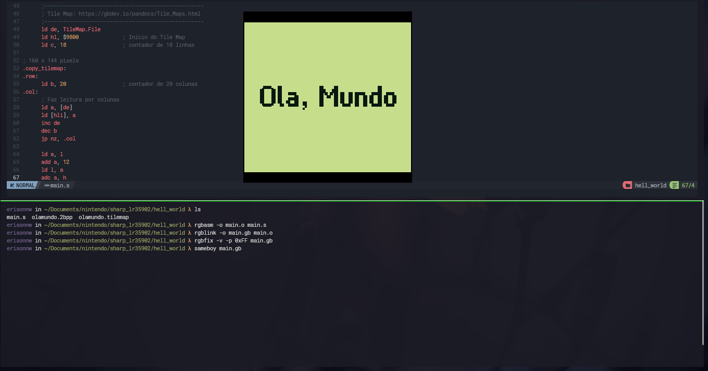

# Sharp LR35902 (Game Boy)

Repositório de estudo do processador **Sharp LR35902** e do hardware do **Game Boy (DMG)** utilizando Assembly e o ecossistema **RGBDS**.

## Resultado


## Estrutura do Repositório

- **`hell_world/`** — Códigos-fonte em Assembly (`main.s`), gráficos binários (`.2bpp` e `.tilemap`) e rotinas comentadas com referências diretas à documentação oficial ([Pan Docs](https://gbdev.io)).
- **`tile-viewer/`** — Ferramenta web (`index.html`) para inspecionar e visualizar arquivos `.2bpp` e `.tilemap` diretamente pelo navegador.

## Visualizador de Tiles (`tile-viewer/`)
Para conferir os sprites, tilesets e mapas de tela antes ou depois de compilar a ROM, abra o arquivo `tile-viewer/index.html` diretamente no seu navegador (não requer servidor ou instalação).

**O que ele faz:**
- Carrega arquivos `.2bpp` (dados brutos dos tiles de 8×8 pixels) e `.tilemap` (grade de índices da tela).
- Permite ajustar a largura e altura da grade (**X × Y**) em tempo real e mostra o tamanho exato em **pixels** (`Largura × Altura px`) para evitar que a imagem fique quebrada ou desalinhada.
- Exibe os gráficos na paleta clássica de 4 tons do Game Boy.

## Como Compilar o Código
Para montar e gerar a ROM (`.gb`), é necessário ter o **[RGBDS](https://gbdev.io)** instalado e um emulador como o **SameBoy** ou **BGB** para executar:

```bash
rgbasm -o main.o main.s
rgblink -o main.gb main.o

# Corrigir o cabeçalho e o checksum do cartucho
rgbfix -v -p 0xFF main.gb
```

## Referências
- [Pan Docs — Documentação Técnica do Game Boy](https://gbdev.io)
- [GB ASM Tutorial](https://gbdev.io)
- [Documentação do RGBDS](https://gbdev.iodocs/)
